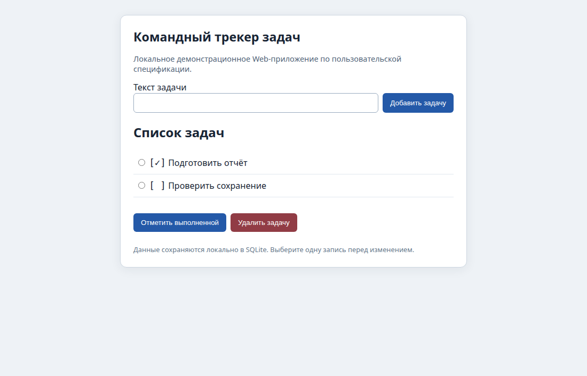

# Лабораторная работа 8. Web-тестирование Selenium

## Цель и исходные условия

Освоить функциональное тестирование Web-интерфейса при помощи Selenium IDE и Selenium WebDriver: задать воспроизводимые сценарии, проверить наблюдаемое состояние интерфейса и постусловия в независимом хранилище. Использованы страницы 134–144 учебника, особенно объяснение проверок и восстановления состояния (с. 138–139), параметризации и постусловий в базе (с. 140) и общие задания 7–8 на с. 144. Проверка выполнялась 18.11.2026 в Linux.

**Объект тестирования — специально созданное локальное демонстрационное Web-приложение**, а не оригинальный desktop EXE пользователя. Его поведение построено по `lab-7/original/Specification.md`: добавление, завершение, удаление, точные тексты предупреждений и сохранение других записей. Исходный `readme.md` описывает Windows-приложение и упоминает запуск `todo_app.py`, но этот исходный файл в предоставленной папке отсутствует; доступен `todo_app.exe`. Поэтому исходный EXE не запускается и его корректность настоящей работой не подтверждается. Веб-интерфейс, radio-кнопки и SQLite — демонстрационная адаптация, а не утверждение о внутреннем устройстве или точной внешности исходной программы.

## Архитектура и спецификация демонстрации

`app.py` — небольшой сервер Python на `ThreadingHTTPServer`, работает по умолчанию только на `127.0.0.1:8765`. Он отображает HTML-формы и принимает запросы `POST /add`, `POST /complete`, `POST /delete`. После успешного изменения выполняется перенаправление на главную страницу; предупреждения отображаются модальным `alert`. Хранилище — SQLite, таблица `tasks(id, title, completed)`, порядок — по идентификатору. SQL-запросы параметризованы. По умолчанию используется `data/demo.sqlite3` внутри каталога работы; путь к файлу можно изменить аргументом `--db`.

* Добавление непустого текста создаёт запись `[ ]` в конце списка и очищает поле. Пустая или состоящая из пробельных символов строка вызывает «Текст задачи не может быть пустым!»; существующие данные не меняются.
* Выделенная невыполненная запись переводится в `[✓]`; повторное завершение сообщает «Эта задача уже выполнена». Без выбора — «Выберите задачу из списка!». Порядок и количество не меняются.
* Удаляется только выбранная запись. Без выбора — «Выберите задачу для удаления!». Остальные тексты, статусы и порядок сохраняются.

В каждом тесте WebDriver создаются новый экземпляр сервера на свободном порту и отдельная пустая SQLite-база; браузер и сервер завершаются в фикстурах. `ui_rows` читает реально отображаемые узлы DOM, `db_rows` — SQLite напрямую, а тесты дополнительно сравнивают полученное состояние с явно заданным ожидаемым. Таким образом, проверка БД не заменена чтением только интерфейса. Данные для параметризации находятся в `task_data.csv`.

## Индивидуальные сценарии и результаты

| Сценарий | Проверяемые послеусловия и инварианты | Результат |
|---|---|---|
| Начальная страница | Заголовок, обязательные элементы, пустые список и БД | Пройден, 1 тест |
| Добавление, данные CSV | 5 независимых входов: кириллица, пунктуация, цифры, символы разметки, обычное имя; текст и статус в DOM и SQLite, пустое поле, сохранение после обновления | Пройдено, 5 тестов |
| Пустой ввод | Пустая строка, пробелы, неразрывный пробел; точное предупреждение и неизменность уже существующей записи в UI и БД | Пройдено, 3 теста |
| Действие без выбора | Завершение и удаление: разные точные предупреждения; данные не меняются | Пройдено, 2 теста |
| Завершение и повтор | Выбрана средняя из трёх записей; изменяется только её статус, повтор показывает предупреждение, сохранение при повторном открытии | Пройден, 1 тест |
| Удаление выбранной | Из трёх записей удаляется средняя; остаются текст, порядок и выполненный статус первой | Пройден, 1 тест |
| Удаление выполненной | Запись сначала завершена, затем удалена; после этого UI и БД пусты | Пройден, 1 тест |
| Большое число записей | Через UI создано 30 записей, включая две с одинаковым текстом; одна завершена, другая удалена по ID; сравнение всего порядка и статусов UI/БД | Пройден, 1 тест |
| Реальное состояние и снимок | В UI/БД две записи: одна выполнена и одна нет; после проверок сохранён снимок окна браузера | Пройден, 1 тест |

Итого финальный запуск WebDriver: **16 из 16 тестов прошли**, `16 passed in 49.84s`. Фактический журнал: [artifacts/pytest.log](artifacts/pytest.log). Среда: Python 3.12.3, Selenium 4.39.0, pytest 8.4.2, headless Chromium 156.0.8078.73 и ChromeDriver 156.0.8078.73. Браузер действительно управлялся WebDriver; скриншот не является макетом:



### Selenium IDE

Проект [tracker.side](tracker.side) содержит три сценария: создание и удаление; завершение, повторное завершение и очистка; предупреждение при пустом вводе. Проект составлен командами вручную через `generate_side.py`, **не записан в расширении**. Он реально воспроизведён инструментом `selenium-side-runner` 4.1.0-beta.3 с headless Chromium: **3 из 3 сценариев прошли**, после набора запрос к тестовой SQLite показал `[]`. Подробный журнал команд, версий, итогов и состояние БД: [artifacts/side-runner.log](artifacts/side-runner.log). Само графическое расширение Selenium IDE отдельно не запускалось и не проверялось.

Последний повтор сделан на новом сервере с чистой базой; в журнале сам runner сообщил `RUNNER_EXIT_CODE=0`. Уже после его завершения одноразовая управляющая оболочка вернула код 2 из-за пустого аргумента команды `exit` (`numeric argument required`); это ошибка завершения оболочки, а не результаты трёх тестов. Проверено, что сервер остановлен. Основной вывод этой оболочки дополнительно сохранён в [artifacts/side-final-wrapper.log](artifacts/side-final-wrapper.log).

Первый запуск WebDriver выявил гонку тестового кода между отправкой формы и загрузкой нового DOM: 10 прошли, 6 не прошли. Это сохранено в [artifacts/pytest-first-run.log](artifacts/pytest-first-run.log). Затем добавлено явное ожидание смены документа. Две ранние попытки runner также сохранены: [первый запуск](artifacts/side-runner-first-run.log) не нашёл конфигурацию Jest, [второй запуск](artifacts/side-runner-second-run.log) выявил отсутствие ожиданий/подтверждения alert. После добавления локальной конфигурации, ожиданий и `acceptAlert` итоговый запуск успешен. Эти ранние неудачи не скрываются и не входят в итоговое число пройденных тестов.

## Воспроизведение

Ниже команды для Linux, выполняемые из корня распакованного комплекта. Нужны Python 3 с `venv`, Chromium и совместимый по версии `chromedriver` в `PATH`; сами браузер и драйвер в эту работу не входят. Браузер и совместимый драйвер должны быть установлены отдельно; Python- и npm-зависимости устанавливаются локально в каталоге работы. Виртуальное окружение, npm-пакеты и временные профили браузера после проверки удалены из комплекта; установите зависимости приведёнными командами. При нестандартных путях установите переменные `CHROMIUM_BINARY` и `CHROMEDRIVER` в абсолютные пути. Не открывайте сервер во внешнюю сеть.

### Создание окружения и ручной запуск демонстрации

```bash
cd lab-8
python3 -m venv .venv
.venv/bin/pip install --no-cache-dir -r requirements.txt
.venv/bin/python app.py
```

Откройте `http://127.0.0.1:8765/`, введите текст и нажмите «Добавить задачу»; чтобы завершить или удалить, сначала выберите запись. Сервер останавливается `Ctrl+C`. Можно указать другую локальную базу: `.venv/bin/python app.py --db data/my-demo.sqlite3`.

### Полный запуск WebDriver

```bash
cd lab-8
mkdir -p artifacts .runtime
export TMPDIR="$PWD/.runtime" XDG_CACHE_HOME="$PWD/.runtime/cache"
export NO_PROXY='localhost,127.0.0.1,::1' no_proxy='localhost,127.0.0.1,::1'
set -o pipefail
.venv/bin/python -m pytest -v -p no:cacheprovider \
  --basetemp="$PWD/.test-tmp" test_web.py 2>&1 | tee artifacts/pytest.log
```

Базы независимы от `data/demo.sqlite3`: они создаются в `.test-tmp`, который pytest очищает при новом запуске. Снимок `artifacts/selenium-demo.png` обновляется последним тестом. Флаги `--no-sandbox` и `--disable-dev-shm-usage` предусмотрены для контейнерной среды, а не как рекомендация для обычной эксплуатации браузера.

### Воспроизведение `.side`

В графическом Selenium IDE можно открыть `tracker.side` как существующий проект, запустить сервер на `http://127.0.0.1:8765/` и выбрать запуск набора; это инструкция для самостоятельной проверки, не отчёт о произведённом запуске расширения. Выполняйте проект на отдельной чистой базе: сценарии создают и удаляют записи с фиксированными именами.

Также проверенный командный вариант. Нужны Node.js 22.23.4 или совместимая версия и npm; зависимости установятся **в этом каталоге**. В первом терминале:

```bash
cd lab-8
mkdir -p data .runtime
# Удалять только эту отдельную демонстрационную базу, когда её сервер остановлен:
rm -f data/ide-run.sqlite3
.venv/bin/python app.py --db data/ide-run.sqlite3
```

Во втором терминале:

```bash
cd lab-8
mkdir -p artifacts .runtime .npm-cache
export TMPDIR="$PWD/.runtime" XDG_CACHE_HOME="$PWD/.runtime/cache"
export npm_config_cache="$PWD/.npm-cache"
export NO_PROXY='localhost,127.0.0.1,::1' no_proxy='localhost,127.0.0.1,::1'
npm install --no-save --no-package-lock --no-audit --no-fund selenium-side-runner@4.1.0-beta.3
set -o pipefail
./node_modules/.bin/selenium-side-runner --max-workers 1 --steps \
  -c 'browserName=chrome goog:chromeOptions.args=[--headless=new,--no-sandbox,--disable-dev-shm-usage]' \
  tracker.side 2>&1 | tee artifacts/side-runner.log
.venv/bin/python -c 'import sqlite3; d=sqlite3.connect("data/ide-run.sqlite3"); print(d.execute("select id,title,completed from tasks order by id").fetchall())'
```

В локальном `jest.config.js` подключена конфигурация runner; не удаляйте файл перед запуском. В конце остановите сервер из первого терминала. В сценариях с предупреждениями используется ожидание 500 мс перед `assertAlert`: на значительно более медленной системе может потребоваться увеличить его в Selenium IDE или генераторе; более надёжное ожидание модального окна реализовано в тестах WebDriver.

## Выводы и ограничения

Для созданного демонстрационного приложения выполнены проверки основных и альтернативных сценариев спецификации, в том числе программные проверки интерфейса и SQLite, параметризация из CSV и массовое добавление. Успешные тесты относятся **только к этой реализации и указанной среде**, а не подтверждают поведение Windows EXE. Надёжность подтверждена одним итоговым прогоном набора, а не статистическим исследованием устойчивости.

Общее задание на с. 144 также предполагает команду из трёх человек, IBM Functional Tester и тестирование desktop-приложения. Эти пункты здесь **не выполнены**; командная работа и рецензия чужого проекта также фактически не проводились, партнёры и оценки не выдумываются. Тестов исходного EXE, графического расширения IDE, Firefox/других браузеров, конкурентных пользователей, нагрузочных характеристик и безопасности развёртывания не проводилось. Приложение является учебной локальной демонстрацией без аутентификации и не предназначено для публичного размещения.
